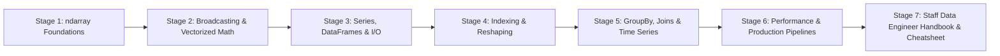
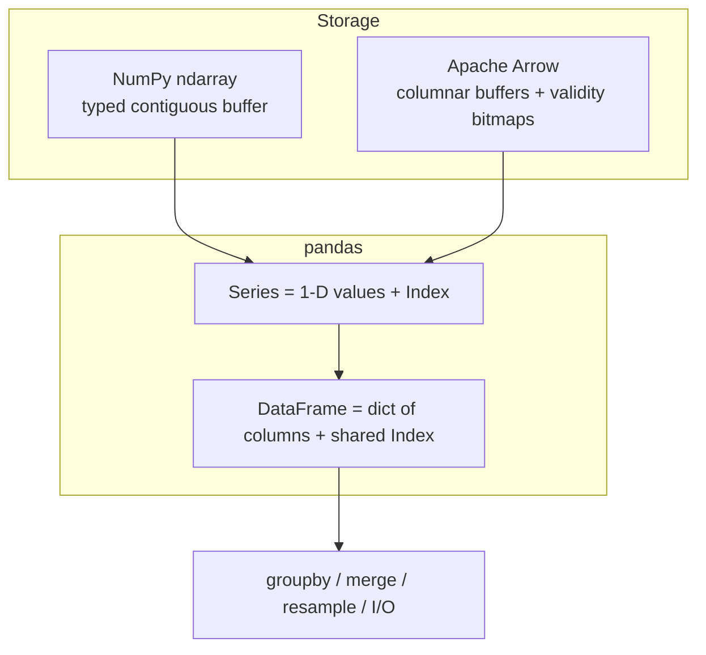
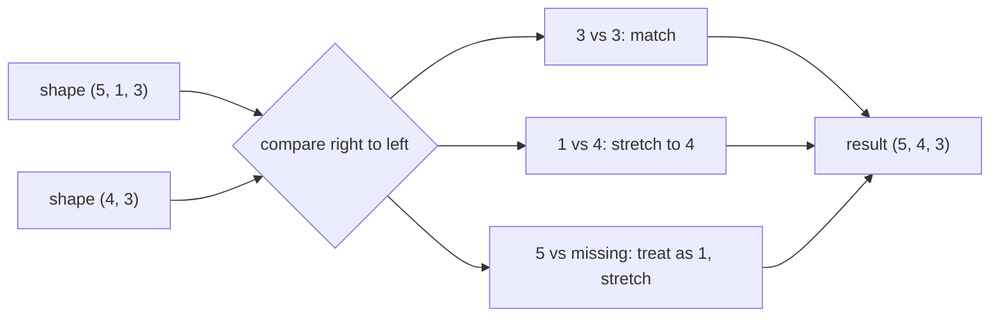
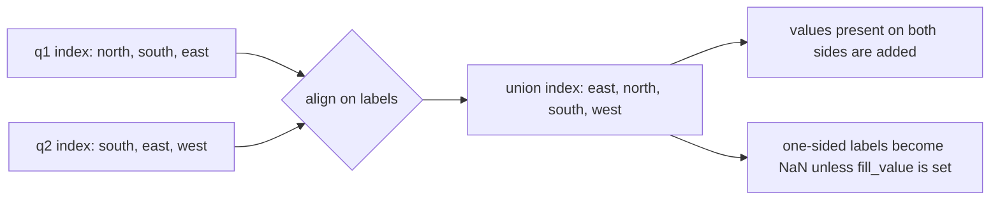
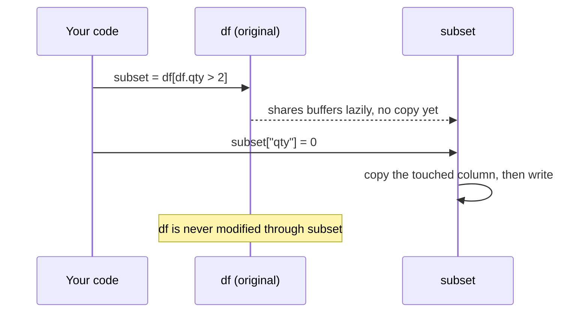
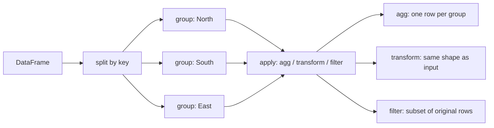
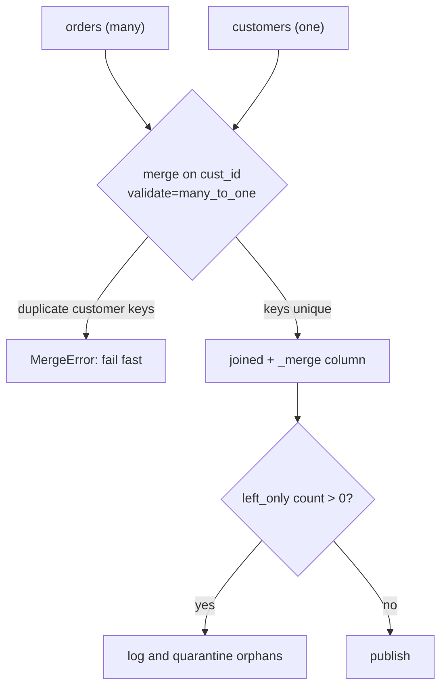
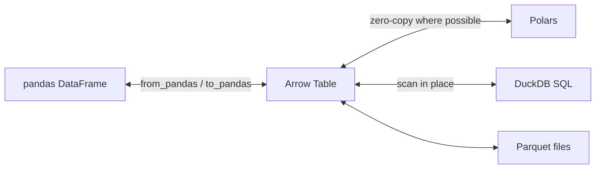

# Learn pandas & NumPy 🐼

<div align="center">

[](https://opensource.org/licenses/MIT)
[](https://www.python.org/)
[](https://pandas.pydata.org/)
[](https://numpy.org/)
[](https://arrow.apache.org/)
[](https://github.com/TheLearningHubOrg/learn-pandas-numpy)

**An exhaustive, production-grade masterclass from absolute zero to staff-level data engineering with pandas and NumPy.**  
Master the ndarray memory model and broadcasting, vectorized math, Series and DataFrames, label and positional indexing, reshaping, groupby and joins, time series, Copy-on-Write, Arrow-backed dtypes and fast, tested data pipelines.

[Getting Started](#1-stage-1-absolute-beginner-foundations--the-ndarray) • [Arrays & Broadcasting](#2-stage-2-numpy-arrays-broadcasting--vectorized-math) • [DataFrames & I/O](#3-stage-3-pandas-core-series-dataframes--io) • [Indexing & Reshaping](#4-stage-4-indexing-selection--reshaping) • [GroupBy, Joins & Time Series](#5-stage-5-groupby-joins--time-series) • [Performance & Pipelines](#6-stage-6-performance-data-quality--production-pipelines) • [Staff Handbook](#7-stage-7-staff-data-engineer-interview-handbook--cheatsheet)

<br/>

<a href="https://www.buymeacoffee.com/manthanank">
  
</a>

</div>

---

## 🗺️ 7-Stage Pedagogical Roadmap



| Stage | Domain Focus | Core Concepts & Production Outcomes |
| :--- | :--- | :--- |
| **Stage 1** | **Absolute Beginner Foundations & the ndarray** | Why vectorized libraries exist, virtual environments, `shape`, `dtype`, `strides`, `np.array`/`np.arange`/`np.linspace`/`np.zeros`, contiguous memory, running the companion pipeline. |
| **Stage 2** | **NumPy Arrays, Broadcasting & Vectorized Math** | ufuncs and `axis=` reductions, the three broadcasting rules, `np.newaxis`, slicing views versus fancy-index copies, boolean masks, `np.where`, `einsum`, `@`, `np.random.default_rng`, NEP 50 type promotion. |
| **Stage 3** | **pandas Core: Series, DataFrames & I/O** | `Index` alignment, nullable `Int64`/`boolean`, the `str` dtype, `category`, `read_csv` with explicit `dtype=`, Parquet, Copy-on-Write semantics in pandas 3, missing data with `pd.NA`. |
| **Stage 4** | **Indexing, Selection & Reshaping** | `.loc`/`.iloc`/`.at`, boolean filters, `query`, `assign` and method chaining, `MultiIndex`, `melt`, `pivot_table`, `unstack`, `.str` and `.dt` accessors, `pd.cut`/`pd.qcut`. |
| **Stage 5** | **GroupBy, Joins & Time Series** | Split-apply-combine, named aggregation, `transform` versus `agg`, `merge(validate=, indicator=)`, `concat`, `merge_asof`, time zones, `resample`, `rolling`, `ewm`, `shift`. |
| **Stage 6** | **Performance, Data Quality & Production Pipelines** | Vectorization over `apply`, memory profiling with `memory_usage(deep=True)`, Arrow-backed dtypes, chunked reads, Parquet partitioning, contract tests, Arrow interop with Polars and DuckDB, containerized batch jobs. |
| **Stage 7** | **Staff Data Engineer Interview Handbook** | 40 staff-level scenario Q&As covering memory layout, silent misalignment, join explosions, time zone bugs, Copy-on-Write migrations, out-of-core strategy and pipeline correctness, plus an enterprise cheatsheet. |

---

## 📋 Table of Contents
- [1. Stage 1: Absolute Beginner Foundations & the ndarray](#1-stage-1-absolute-beginner-foundations--the-ndarray)
  - [1.1 Why NumPy & pandas Exist](#11-why-numpy--pandas-exist)
  - [1.2 Installation & Environment Setup](#12-installation--environment-setup)
  - [1.3 Anatomy of an ndarray](#13-anatomy-of-an-ndarray)
  - [1.4 Creating Arrays & Choosing dtypes](#14-creating-arrays--choosing-dtypes)
  - [1.5 Running the Companion Project](#15-running-the-companion-project)
- [2. Stage 2: NumPy Arrays, Broadcasting & Vectorized Math](#2-stage-2-numpy-arrays-broadcasting--vectorized-math)
  - [2.1 Universal Functions & Axis Reductions](#21-universal-functions--axis-reductions)
  - [2.2 The Broadcasting Rules](#22-the-broadcasting-rules)
  - [2.3 Slicing, Boolean Masks & Fancy Indexing](#23-slicing-boolean-masks--fancy-indexing)
  - [2.4 Views, Copies & Memory Layout](#24-views-copies--memory-layout)
  - [2.5 Linear Algebra, einsum & Random Generators](#25-linear-algebra-einsum--random-generators)
  - [2.6 Type Promotion in NumPy 2](#26-type-promotion-in-numpy-2)
- [3. Stage 3: pandas Core: Series, DataFrames & I/O](#3-stage-3-pandas-core-series-dataframes--io)
  - [3.1 Series & Index Alignment](#31-series--index-alignment)
  - [3.2 DataFrames & the Modern dtype System](#32-dataframes--the-modern-dtype-system)
  - [3.3 Reading & Writing Data](#33-reading--writing-data)
  - [3.4 Copy-on-Write & pandas 3 Semantics](#34-copy-on-write--pandas-3-semantics)
  - [3.5 Missing Data Done Right](#35-missing-data-done-right)
- [4. Stage 4: Indexing, Selection & Reshaping](#4-stage-4-indexing-selection--reshaping)
  - [4.1 loc, iloc, at & iat](#41-loc-iloc-at--iat)
  - [4.2 Boolean Filters & query](#42-boolean-filters--query)
  - [4.3 assign & Method Chaining](#43-assign--method-chaining)
  - [4.4 MultiIndex Deep Dive](#44-multiindex-deep-dive)
  - [4.5 Wide & Long: melt, pivot_table & unstack](#45-wide--long-melt-pivot_table--unstack)
  - [4.6 String, Datetime & Categorical Accessors](#46-string-datetime--categorical-accessors)
- [5. Stage 5: GroupBy, Joins & Time Series](#5-stage-5-groupby-joins--time-series)
  - [5.1 Split-Apply-Combine](#51-split-apply-combine)
  - [5.2 agg, transform, filter & apply](#52-agg-transform-filter--apply)
  - [5.3 merge, join & concat](#53-merge-join--concat)
  - [5.4 As-Of Joins for Event Data](#54-as-of-joins-for-event-data)
  - [5.5 Timestamps, Time Zones & resample](#55-timestamps-time-zones--resample)
  - [5.6 Window Functions: rolling, expanding & ewm](#56-window-functions-rolling-expanding--ewm)
- [6. Stage 6: Performance, Data Quality & Production Pipelines](#6-stage-6-performance-data-quality--production-pipelines)
  - [6.1 Vectorize First: The Cost of apply](#61-vectorize-first-the-cost-of-apply)
  - [6.2 Memory Engineering & Arrow-Backed dtypes](#62-memory-engineering--arrow-backed-dtypes)
  - [6.3 Out-of-Core: Chunking & Partitioned Parquet](#63-out-of-core-chunking--partitioned-parquet)
  - [6.4 Data Contracts & Pipeline Testing](#64-data-contracts--pipeline-testing)
  - [6.5 Interop with Arrow, Polars & DuckDB](#65-interop-with-arrow-polars--duckdb)
  - [6.6 Containerizing the Batch Job](#66-containerizing-the-batch-job)
- [7. Stage 7: Staff Data Engineer Interview Handbook & Cheatsheet](#7-stage-7-staff-data-engineer-interview-handbook--cheatsheet)
  - [7.1 Enterprise Production Cheatsheet](#71-enterprise-production-cheatsheet)
  - [7.2 Staff & Principal Architect Interview Q&A (40 Scenarios)](#72-staff--principal-architect-interview-qa-40-scenarios)
- [🤝 Contributing](#-contributing)
- [📄 License](#-license)

---

## 1. Stage 1: Absolute Beginner Foundations & the ndarray

### 1.1 Why NumPy & pandas Exist

A Python list stores pointers. Each element is a full Python object with its own type tag and reference count, scattered across the heap. Adding two lists of a million floats means a million trips through the interpreter, a million type checks and a million new objects.

NumPy replaces that with one block of raw, typed memory and pushes the loop down into compiled C. pandas builds on the same idea and adds labels, heterogeneous columns, missing-data handling, I/O and relational operations.

```
Python list of floats                 NumPy float64 array
+-----+-----+-----+-----+             +--------+--------+--------+--------+
| ptr | ptr | ptr | ptr |             | 1.0    | 2.0    | 3.0    | 4.0    |
+--+--+--+--+--+--+--+--+             +--------+--------+--------+--------+
   |     |     |     |                 8 bytes  8 bytes  8 bytes  8 bytes
   v     v     v     v                 one contiguous buffer, one dtype
 PyFloat objects all over the heap     loops run in C, SIMD friendly
```

The practical consequences shape the whole guide:

1. **Vectorize everything:** an expression like `prices * qty` runs as one compiled loop. A Python `for` over rows is typically 50 to 500 times slower.
2. **dtypes are a contract:** a column is one type. When data does not fit (a stray `"N/A"` in a numeric column), the library falls back to `object` and all the speed goes away.
3. **Memory is the real limit:** a frame of $10^8$ rows by 10 `float64` columns is $10^8 \times 10 \times 8 = 8$ GB before any intermediate copies.



### 1.2 Installation & Environment Setup

Always install into a project-local virtual environment. pandas 3 needs Python 3.11 or newer and NumPy 2.

```bash
# 1. Create and activate an isolated environment
python -m venv .venv
source .venv/bin/activate          # Windows: .venv\Scripts\activate

# 2. Install the core stack plus optional accelerators
python -m pip install --upgrade pip
python -m pip install "pandas>=2.2" "numpy>=2.0" pyarrow pytest

# 3. Confirm versions and the BLAS backend NumPy links against
python -c "import pandas as pd, numpy as np; print(pd.__version__, np.__version__)"
python -c "import numpy as np; np.show_config()"

# 4. Optional: notebooks for exploration (never for production jobs)
python -m pip install jupyterlab
```

`pyarrow` is optional but strongly recommended: it powers the fast CSV reader, Parquet I/O and Arrow-backed dtypes covered in Stage 6.

### 1.3 Anatomy of an ndarray

Every array is a small header object pointing at a data buffer. The header holds four facts that decide how memory is read:

1. **`dtype`:** how to interpret each element's bytes (`float64`, `int32`, `bool`, `datetime64[ns]`).
2. **`shape`:** the size along each axis, e.g. `(3, 4)`.
3. **`strides`:** how many bytes to jump to move one step along each axis.
4. **`data`:** the buffer itself, possibly shared with other arrays.

```python
import numpy as np

# 1. A 3 x 4 grid of 64-bit integers
grid = np.arange(12, dtype=np.int64).reshape(3, 4)
print(grid)
print("shape:", grid.shape)        # (3, 4)
print("ndim:", grid.ndim)          # 2
print("dtype:", grid.dtype)        # int64
print("itemsize:", grid.itemsize)  # 8 bytes per element
print("nbytes:", grid.nbytes)      # 96 = 12 * 8
print("strides:", grid.strides)    # (32, 8): next row is 32 bytes away, next column 8

# 2. Transposing changes only the header, not the data
flipped = grid.T
print("T strides:", flipped.strides)               # (8, 32)
print("shares memory:", np.shares_memory(grid, flipped))  # True

# 3. Memory order flags
print(grid.flags["C_CONTIGUOUS"], flipped.flags["C_CONTIGUOUS"])  # True False
```

Element `grid[i, j]` lives at byte offset $i \times 32 + j \times 8$. Transpose, slicing with a step and `reshape` (when possible) only rewrite shape and strides. That is why they are effectively free regardless of array size.

### 1.4 Creating Arrays & Choosing dtypes

```python
import numpy as np

# 1. From Python data (dtype is inferred)
a = np.array([1, 2, 3])                 # int64 on most platforms
b = np.array([1.0, 2, 3])               # float64: one float upcasts the lot

# 2. Constructors that avoid Python loops entirely
zeros = np.zeros((2, 3))                # float64 zeros
ones = np.ones(5, dtype=np.int32)
steps = np.arange(0, 1, 0.25)           # [0, 0.25, 0.5, 0.75], end excluded
grid = np.linspace(0, 1, 5)             # [0, 0.25, 0.5, 0.75, 1.0], end included
eye = np.eye(3)                          # identity matrix
filled = np.full((2, 2), np.nan)

# 3. Pick the smallest dtype that safely holds your data
sensor = np.array([12, 250, 37], dtype=np.uint8)   # 1 byte each
print(sensor.nbytes)                                # 3

# 4. Dates are first-class
days = np.arange("2026-01-01", "2026-01-08", dtype="datetime64[D]")
print(days[-1] - days[0])                           # 6 days

# 5. Convert explicitly; astype always returns a new array
as_float = sensor.astype(np.float32)
```

Prefer `np.linspace` over `np.arange` for non-integer steps: floating-point accumulation can make `arange` return one element more or less than you expect.

### 1.5 Running the Companion Project

This repository ships a small but complete pipeline under `src/pipeline/` with sample CSV data in `data/` and a pytest suite in `tests/`.

```
learn-pandas-numpy/
├── data/
│   ├── customers.csv        # dimension: customer_id, name, region, signup_date
│   ├── orders.csv           # fact: one row per order, with a duplicate, a blank and cancellations
│   └── products.csv         # dimension: product_id, name, category, list_price
├── src/pipeline/
│   ├── arrays.py            # zscore, moving_average, pairwise_distances, normalize_rows
│   ├── frames.py            # typed loaders and the validated fact-table join
│   ├── analytics.py         # groupby, pivots, resample, rolling, transform
│   └── __main__.py          # python -m pipeline -> text report
├── tests/test_pipeline.py   # compares pandas output against a pure-Python reference
├── Dockerfile
├── pyproject.toml
└── requirements.txt
```

```bash
# 1. Install dependencies into a local environment
python -m venv .venv && source .venv/bin/activate
python -m pip install -r requirements.txt

# 2. Run the report
PYTHONPATH=src python -m pipeline data

# 3. Run the test suite, treating every warning as an error
python -m pytest -q -W error
```

The test file deliberately recomputes every number with the `csv` module so pandas is never used to check pandas.

---

## 2. Stage 2: NumPy Arrays, Broadcasting & Vectorized Math

### 2.1 Universal Functions & Axis Reductions

A **ufunc** applies an operation element by element in compiled code: `np.add`, `np.exp`, `np.sqrt`, comparison operators and more. Reductions such as `sum`, `mean`, `max` and `argmax` collapse an axis.

The rule for `axis=` is simple: **the axis you name is the one that disappears.**

```python
import numpy as np

# Rows are stores, columns are weekdays
sales = np.array([
    [120, 135, 150, 110, 180],
    [ 90,  95, 100,  85, 140],
    [200, 210, 190, 205, 260],
], dtype=np.float64)

# 1. Element-wise ufuncs
taxed = sales * 1.08
logged = np.log1p(sales)          # log(1 + x), stable near zero

# 2. Reductions: the named axis is removed
per_day = sales.sum(axis=0)       # shape (5,): total per weekday
per_store = sales.mean(axis=1)    # shape (3,): average per store
best_day = sales.argmax(axis=1)   # index of the best day for each store

# 3. keepdims keeps the reduced axis as length 1, ready for broadcasting
share = sales / sales.sum(axis=1, keepdims=True)
print(share.sum(axis=1))          # [1. 1. 1.]

# 4. Cumulative and difference operations
running = np.cumsum(sales, axis=1)
day_over_day = np.diff(sales, axis=1)

# 5. NaN-aware variants ignore missing values
with_gap = sales.copy()
with_gap[1, 2] = np.nan
print(np.nanmean(with_gap, axis=1))
```

Ufuncs also accept `out=` and `where=`, which lets you avoid temporaries and handle edge cases such as division by zero without warnings: `np.divide(a, b, out=np.zeros_like(a), where=b != 0)`.

### 2.2 The Broadcasting Rules

Broadcasting lets arrays of different shapes take part in one expression without copying data. NumPy compares shapes **from the trailing axis backwards**:

1. **Equal sizes match.**
2. **A size of 1 stretches** to match the other side.
3. **A missing leading axis** is treated as size 1.

If any pair of sizes is unequal and neither is 1, NumPy raises `ValueError: operands could not be broadcast together`.

```
A:      (4, 3)            A:      (4, 3)            A:      (4, 3)
B:         (3,)           B:      (4, 1)            B:      (4,)
        -------                   -------                   -------
result: (4, 3)  OK        result: (4, 3)  OK        trailing 3 vs 4: ERROR
```



```python
import numpy as np

# 1. Center each column (feature) of a 2-D dataset
X = np.array([[1.0, 200.0], [2.0, 220.0], [3.0, 260.0]])
centered = X - X.mean(axis=0)               # (3, 2) - (2,) -> (3, 2)

# 2. Outer product without np.outer: (3, 1) * (1, 4) -> (3, 4)
rows = np.arange(1, 4)[:, np.newaxis]
cols = np.arange(1, 5)[np.newaxis, :]
table = rows * cols

# 3. All pairwise distances between two point sets in one expression
rng = np.random.default_rng(7)
points = rng.normal(size=(1000, 3))
centroids = rng.normal(size=(8, 3))
diff = points[:, None, :] - centroids[None, :, :]   # (1000, 8, 3)
dist = np.sqrt((diff ** 2).sum(axis=-1))             # (1000, 8)
labels = dist.argmin(axis=1)                          # nearest centroid per point
print(dist.shape, labels[:10])
```

Broadcasting avoids copying the inputs, but the **result** is fully materialized. In step 3, the intermediate cube holds $1000 \times 8 \times 3 = 24{,}000$ floats. With a million points and a thousand centroids it would be $10^6 \times 10^3 \times 3 \times 8$ bytes $= 24$ GB. At that scale, use the expansion $\lVert a-b \rVert^2 = \lVert a \rVert^2 + \lVert b \rVert^2 - 2\,a \cdot b$ with a matrix multiply, or process points in chunks. The companion `pairwise_distances` uses `einsum` to avoid squaring into a second cube.

### 2.3 Slicing, Boolean Masks & Fancy Indexing

NumPy has three indexing styles and they behave differently with respect to memory:

| Style | Example | Returns |
| :--- | :--- | :--- |
| **Basic slicing** | `a[1:5]`, `a[::2]`, `a[:, 0]` | A **view** that shares memory. |
| **Boolean mask** | `a[a > 0]` | A new 1-D **copy**. |
| **Fancy (integer array)** | `a[[0, 3, 7]]` | A new **copy**, in the order given. |

```python
import numpy as np

temps = np.array([18.5, 21.0, 35.2, 19.8, -40.0, 22.1, 99.9])

# 1. Boolean masks combine with & | ~ (always parenthesize comparisons)
valid = (temps > -30) & (temps < 60)
clean = temps[valid]

# 2. np.where as a vectorized if/else
capped = np.where(temps > 30, 30.0, temps)

# 3. np.select for multi-branch logic
labels = np.select(
    [temps < 0, temps < 20, temps < 30],
    ["freezing", "cool", "warm"],
    default="hot",
)

# 4. Fancy indexing picks and reorders
order = np.argsort(temps)
coldest_three = temps[order[:3]]

# 5. Assignment through a mask writes into the original array
temps[~valid] = np.nan
print(temps)

# 6. 2-D: select rows by mask, columns by position
m = np.arange(20).reshape(4, 5)
print(m[m[:, 0] > 4][:, [1, 3]])
```

Use `&`, `|` and `~`, never `and`, `or` and `not`, on arrays. The Python keywords try to reduce the whole array to a single truth value and raise `ValueError: The truth value of an array ... is ambiguous`.

### 2.4 Views, Copies & Memory Layout

Views are what make NumPy fast, and they are also its sharpest edge: writing through a view changes the original.

```python
import numpy as np

base = np.arange(10)

# 1. Slices are views
window = base[2:6]
window[:] = -1
print(base)                                  # [ 0  1 -1 -1 -1 -1  6  7  8  9]

# 2. Ask NumPy instead of guessing
print(np.shares_memory(base, window))        # True
print(window.base is base)                   # True

# 3. Take an explicit copy when you need isolation
safe = base[2:6].copy()
safe[:] = 100
print(base[2:6])                             # unchanged

# 4. Layout matters: iterate along the contiguous axis
big = np.ones((4000, 4000))
row_sums = big.sum(axis=1)                   # walks contiguous memory per row
col_sums = big.sum(axis=0)                   # strided access; NumPy still optimizes

# 5. Force a layout when handing data to C, Fortran or GPU code
f_order = np.asfortranarray(big)
print(f_order.flags["F_CONTIGUOUS"])         # True
```

Two habits keep this safe:

1. **In library code, never mutate an input array.** Copy it, or compute a new result.
2. **Keep arrays contiguous before heavy work.** `np.ascontiguousarray` costs one copy and can speed up every later pass through cache-friendly access.

### 2.5 Linear Algebra, einsum & Random Generators

```python
import numpy as np

rng = np.random.default_rng(seed=2026)        # Generator API: use this, not np.random.seed

# 1. Matrix multiply with @ (dispatches to BLAS)
A = rng.normal(size=(3, 3))
x_true = np.array([1.0, -2.0, 0.5])
b = A @ x_true

# 2. Solve instead of inverting: faster and numerically safer
x = np.linalg.solve(A, b)
print(np.allclose(x, x_true))                 # True

# 3. Least squares for an over-determined system (linear regression)
n = 200
X = np.column_stack([np.ones(n), rng.uniform(0, 10, n)])
y = 3.0 + 1.5 * X[:, 1] + rng.normal(0, 0.5, n)
coef, *_ = np.linalg.lstsq(X, y, rcond=None)
print(coef.round(2))                          # close to [3.0, 1.5]

# 4. einsum names the axes explicitly
batch = rng.normal(size=(32, 4, 5))
weights = rng.normal(size=(5, 2))
out = np.einsum("bij,jk->bik", batch, weights)    # batched matmul, (32, 4, 2)
traces = np.einsum("ii->", A)                     # trace of A

# 5. Independent, reproducible streams for parallel workers
streams = [np.random.default_rng(s) for s in np.random.SeedSequence(42).spawn(4)]
print([round(g.random(), 4) for g in streams])
```

`np.linalg.inv(A) @ b` computes a full inverse and loses precision on ill-conditioned matrices. `solve` factorizes once and is the right default. For random numbers, `default_rng` with `SeedSequence.spawn` gives each worker a statistically independent stream, which the legacy global `np.random.seed` cannot.

### 2.6 Type Promotion in NumPy 2

NumPy 2 adopted **NEP 50**: the result dtype now depends on the dtypes of the arrays involved, not on the values inside them. Python scalars (`int`, `float`) are "weak" and adapt to the array's dtype.

```python
import numpy as np

f32 = np.ones(3, dtype=np.float32)

# 1. A Python float no longer upcasts a float32 array
print((f32 * 2.5).dtype)                        # float32

# 2. A NumPy float64 scalar is "strong" and does upcast
print((f32 * np.float64(2.5)).dtype)            # float64

# 3. Integer overflow is silent for arrays: choose dtypes deliberately
counts = np.array([250], dtype=np.uint8)
print(counts + 10)                              # [4] -- wrapped around
print(counts.astype(np.int64) + 10)             # [260]

# 4. Removed aliases from NumPy 1.x
# np.float_ -> np.float64, np.NaN -> np.nan, np.Inf -> np.inf
```

When upgrading old code, the most common breakages are removed aliases (`np.float_`, `np.NaN`, `np.product`) and changed promotion where code relied on value-based upcasting. Ruff's `NPY201` rule flags most of them automatically.

---

## 3. Stage 3: pandas Core: Series, DataFrames & I/O

### 3.1 Series & Index Alignment

A `Series` is a 1-D array plus an `Index` of labels. The single most important behaviour in pandas follows from that: **arithmetic aligns on labels, not positions.**

```python
import pandas as pd

q1 = pd.Series({"north": 120, "south": 95, "east": 80})
q2 = pd.Series({"south": 110, "east": 85, "west": 60})

# 1. Labels are matched; anything present on one side only becomes NaN
print(q1 + q2)
# east      165.0
# north       NaN
# south     205.0
# west        NaN

# 2. Fill the gaps explicitly when "missing" really means zero
print(q1.add(q2, fill_value=0))

# 3. Positional arithmetic requires dropping the labels on purpose
print(q1.to_numpy() + q2.to_numpy())    # [230 180 140]: adds north to south, a silent bug

# 4. Index operations are set operations
print(q1.index.intersection(q2.index))   # south, east
print(q1.index.union(q2.index))
```



Alignment is a feature when combining data from different sources. It is also the root of the classic silent bug: assigning a Series with a different index into a DataFrame column fills unmatched rows with `NaN` and raises no error.

### 3.2 DataFrames & the Modern dtype System

A `DataFrame` is a dictionary of same-length columns sharing one row index. Each column has exactly one dtype.

```python
import numpy as np
import pandas as pd

df = pd.DataFrame(
    {
        "sku": ["A-1", "B-2", "C-3", "D-4"],
        "qty": pd.array([3, None, 7, 1], dtype="Int64"),        # nullable integer
        "price": [9.99, 24.50, np.nan, 4.25],                    # float64 with NaN
        "in_stock": pd.array([True, False, None, True], dtype="boolean"),
        "tier": pd.Categorical(["gold", "basic", "gold", "silver"],
                               categories=["basic", "silver", "gold"], ordered=True),
        "updated": pd.to_datetime(["2026-03-01", "2026-03-02", "2026-03-02", "2026-03-05"]),
    }
)

print(df.dtypes)
df.info(memory_usage="deep")            # info() prints directly and returns None

# Ordered categoricals compare by category order, not alphabetically
print(df.loc[df["tier"] >= "silver", "sku"].tolist())   # ['A-1', 'C-3', 'D-4']
```

| dtype | Use it for | Missing value |
| :--- | :--- | :--- |
| `float64` | Measurements, money in analytics (not ledgers) | `NaN` |
| `int64` | Counts and ids with no gaps | Cannot hold missing |
| `Int64` / `Int32` | Integers that may be missing | `pd.NA` |
| `boolean` | Flags that may be unknown | `pd.NA` |
| `str` / `string` | Text. pandas 3 infers `str` by default | `NaN` (`str`) or `pd.NA` (`string`) |
| `category` | Low-cardinality labels, ordered levels | `NaN` |
| `datetime64[us]`, `datetime64[us, UTC]` | Timestamps, naive or tz-aware | `NaT` |
| `int64[pyarrow]` and friends | Arrow-backed columns for speed and interop | `pd.NA` |

Before pandas 3, text columns defaulted to `object`, an array of Python pointers. pandas 3 infers a dedicated string dtype that is Arrow-backed when `pyarrow` is installed. It uses less memory, has faster `.str` methods and rejects non-string values. Datetimes parsed from strings now default to microsecond resolution (`datetime64[us]`) rather than nanoseconds, which widens the representable range far beyond the old 1677 to 2262 window.

### 3.3 Reading & Writing Data

The fastest way to break a pipeline is to let `read_csv` guess. Declare dtypes, parse dates on purpose and fail early.

```python
import io
import pandas as pd

raw = io.StringIO(
    "order_id,placed_at,customer,amount,status\n"
    "1,2026-04-01 09:15,acme,120.50,paid\n"
    "2,2026-04-01 10:02,globex,,pending\n"
    "3,2026-04-02 14:40,acme,75.00,paid\n"
)

orders = pd.read_csv(
    raw,
    dtype={"order_id": "int64", "customer": "string", "amount": "float64",
           "status": "category"},
    parse_dates=["placed_at"],
    na_values=["", "N/A", "null"],
    usecols=["order_id", "placed_at", "customer", "amount", "status"],
)
print(orders.dtypes)

# Parquet keeps dtypes, compresses well and reads only the columns you ask for
orders.to_parquet("orders.parquet", index=False)
amounts = pd.read_parquet("orders.parquet", columns=["order_id", "amount"])
print(amounts)
```

Format choice in production:

1. **Parquet:** the default for anything that is not a hand-off to a human. Typed, columnar, compressed, supports column pruning and predicate pushdown.
2. **CSV:** interchange only. Always pass `dtype=`, and consider `engine="pyarrow"` for multi-threaded parsing of large files.
3. **Feather/Arrow IPC:** very fast local caching between processes.
4. **SQL:** `pd.read_sql` with SQLAlchemy, always with a bounded query and `chunksize` for large results.
5. **Excel:** for business stakeholders only. Pin the engine (`openpyxl`) and validate the sheet layout before parsing.

### 3.4 Copy-on-Write & pandas 3 Semantics

In pandas 3, **Copy-on-Write (CoW)** is the only mode. Every indexing operation behaves as if it returned a copy. Internally pandas shares memory lazily and copies only when one side is modified.



```python
import pandas as pd

df = pd.DataFrame({"qty": [1, 5, 9], "price": [2.0, 3.0, 4.0]})

# 1. Modifying a derived object never touches the parent
subset = df[df["qty"] > 2]
subset["qty"] = 0
print(df["qty"].tolist())          # [1, 5, 9]

# 2. Chained assignment never updates df (pandas warns about it)
# df["qty"][df["qty"] > 2] = 0     # wrong: writes to a temporary

# 3. The one correct pattern for conditional updates
df.loc[df["qty"] > 2, "qty"] = 0
print(df["qty"].tolist())          # [1, 0, 0]

# 4. Methods return new objects cheaply; prefer reassignment over inplace=True
df = df.rename(columns={"qty": "quantity"})
```

Other pandas 3 changes worth knowing when migrating:

1. **`SettingWithCopyWarning` is gone:** CoW makes the behaviour defined, so the warning no longer exists.
2. **String dtype inference:** text columns come back as `str`, not `object`. Code that checks `dtype == object` needs updating.
3. **`groupby(..., observed=True)`** is the default for categorical groupers, so unobserved category combinations no longer appear.
4. **Offset aliases:** use `"ME"`, `"QE"`, `"YE"` for period ends and lowercase `"h"`, `"min"`, `"s"`. The old `"M"` and `"H"` spellings were deprecated in 2.2.

On pandas 2.2 you can opt in early with `pd.options.mode.copy_on_write = True` and fix every warning before upgrading.

### 3.5 Missing Data Done Right

pandas has three missing markers: `np.nan` (float), `pd.NaT` (datetimes) and `pd.NA` (nullable and Arrow dtypes). Use `isna()` for all of them. Never compare with `== np.nan`, which is always `False`.

```python
import numpy as np
import pandas as pd

readings = pd.DataFrame(
    {
        "sensor": ["s1", "s1", "s1", "s2", "s2", "s2"],
        "ts": pd.date_range("2026-05-01", periods=3, freq="h").tolist() * 2,
        "value": [10.0, np.nan, 12.0, np.nan, 7.5, 8.0],
    }
)

# 1. Inspect before you fix
print(readings.isna().sum())
print(readings["value"].isna().mean())        # share of missing values

# 2. Pick a strategy per column, and per group where it matters
readings["ffilled"] = readings.groupby("sensor")["value"].ffill()
readings["interp"] = readings.groupby("sensor")["value"].transform(
    lambda s: s.interpolate(limit_direction="both")
)
readings["filled_zero"] = readings["value"].fillna(0)

# 3. Drop only when you can justify it, and only on the columns that matter
complete = readings.dropna(subset=["value"])

# 4. Nullable integers keep ints as ints
ids = pd.Series([1, None, 3], dtype="Int64")
print(ids + 1)                                # 2, <NA>, 4  (no float conversion)
print(readings)
```

Grouping before `ffill` is essential: without it, the last reading of sensor `s1` leaks into the first row of sensor `s2`.

---

## 4. Stage 4: Indexing, Selection & Reshaping

### 4.1 loc, iloc, at & iat

| Accessor | Selects by | Slice end | Typical use |
| :--- | :--- | :--- | :--- |
| `df.loc[rows, cols]` | Labels and boolean masks | **Inclusive** | Production code, conditional updates |
| `df.iloc[rows, cols]` | Integer positions | Exclusive | Head/tail logic, positional sampling |
| `df.at[row, col]` | One label pair | n/a | Fast scalar read or write |
| `df.iat[i, j]` | One position pair | n/a | Fast scalar by position |

```python
import pandas as pd

stock = pd.DataFrame(
    {"qty": [12, 0, 7, 3], "price": [2.5, 9.0, 4.0, 15.0]},
    index=pd.Index(["apple", "kiwi", "mango", "papaya"], name="item"),
)

# 1. Label slices include both ends
print(stock.loc["kiwi":"mango"])                 # kiwi and mango

# 2. Position slices exclude the end
print(stock.iloc[1:3])                           # kiwi and mango as well

# 3. Rows by mask, columns by label, in one call
print(stock.loc[stock["qty"] > 0, ["price"]])

# 4. Scalars
stock.at["kiwi", "qty"] = 20
print(stock.iat[1, 0])                           # 20

# 5. Plain [] is for columns; avoid it for rows
prices = stock["price"]                          # Series
subset = stock[["qty", "price"]]                 # DataFrame
```

Write one rule into your team's style guide: **rows go through `.loc` or `.iloc`, never through bare `[]`.** It removes a whole class of ambiguity between labels and positions, especially when the index is made of integers.

### 4.2 Boolean Filters & query

```python
import pandas as pd

trips = pd.DataFrame(
    {
        "city": ["Pune", "Oslo", "Lima", "Oslo", "Pune", "Kyiv"],
        "km": [12.0, 3.5, 40.2, 8.1, 0.9, 15.0],
        "fare": [180, 95, 420, 130, 40, 210],
        "rating": [4.8, 3.9, 4.5, 4.9, 2.5, 4.1],
    }
)

# 1. Masks with & | ~ and parentheses
long_good = trips[(trips["km"] > 5) & (trips["rating"] >= 4.5)]

# 2. Membership and ranges
nordic = trips[trips["city"].isin(["Oslo", "Kyiv"])]
mid = trips[trips["km"].between(5, 20)]

# 3. query reads like SQL; @ references local variables
min_fare = 100
print(trips.query("fare >= @min_fare and city != 'Lima'"))

# 4. Top N without a full sort
print(trips.nlargest(2, "fare"))
```

`query` is convenient in notebooks and readable in pipelines. It parses a string, so typos fail at runtime rather than in your editor. Many teams allow it for ad-hoc analysis and prefer explicit masks in library code.

### 4.3 assign & Method Chaining

Method chaining expresses a transformation as a readable top-to-bottom recipe with no half-built intermediate variables. Under CoW it is also cheap, because unchanged columns are shared instead of copied.

```python
import pandas as pd

raw = pd.DataFrame(
    {
        "Order ID": [1, 2, 3, 4],
        "Unit Price": ["10.5", "3.0", "7.25", "bad"],
        "Qty": [2, 10, 4, 1],
        "Country": [" in", "US ", "in", "de"],
    }
)

clean = (
    raw
    .rename(columns=lambda c: c.strip().lower().replace(" ", "_"))
    .assign(
        unit_price=lambda d: pd.to_numeric(d["unit_price"], errors="coerce"),
        country=lambda d: d["country"].str.strip().str.upper(),
    )
    .dropna(subset=["unit_price"])
    .assign(revenue=lambda d: d["unit_price"] * d["qty"])
    .sort_values("revenue", ascending=False)
    .reset_index(drop=True)
)
print(clean)

# pipe() inserts your own functions into the chain
def flag_large(df: pd.DataFrame, threshold: float) -> pd.DataFrame:
    return df.assign(is_large=df["revenue"] >= threshold)

print(clean.pipe(flag_large, threshold=25))
```

The `lambda d:` inside `assign` receives the frame **as it is at that point in the chain**, so later columns can depend on earlier ones without naming a temporary variable.

### 4.4 MultiIndex Deep Dive

A `MultiIndex` stores hierarchical row or column labels. It is what `groupby` with several keys returns, and it is the natural shape for panel data such as (store, date) or (region, product).

```python
import pandas as pd

idx = pd.MultiIndex.from_product(
    [["north", "south"], ["2026-01", "2026-02", "2026-03"]],
    names=["region", "month"],
)
sales = pd.DataFrame({"revenue": [10, 12, 15, 7, 9, 8],
                      "orders": [3, 4, 5, 2, 3, 3]}, index=idx)

# 1. Select an outer level
print(sales.loc["north"])

# 2. Select a cross-section on an inner level
print(sales.xs("2026-02", level="month"))

# 3. Slice inner levels with pd.IndexSlice (the index must be sorted)
ix = pd.IndexSlice
print(sales.sort_index().loc[ix[:, "2026-02":"2026-03"], :])

# 4. Aggregate by level, swap and flatten
print(sales.groupby(level="region").sum())
flat = sales.reset_index()                       # back to plain columns
print(flat.head())
```

Keep a `MultiIndex` sorted (`sort_index()`) before slicing. An unsorted index makes range slices raise `UnsortedIndexError` and turns label lookups into slow linear scans.

### 4.5 Wide & Long: melt, pivot_table & unstack

```
Wide (one column per month)              Long (one row per observation)
+--------+------+------+------+           +--------+-------+-------+
| store  | jan  | feb  | mar  |   melt    | store  | month | sales |
+--------+------+------+------+  ------>  +--------+-------+-------+
| s1     | 100  | 120  | 90   |           | s1     | jan   | 100   |
| s2     | 80   | 85   | 110  |  <------  | s1     | feb   | 120   |
+--------+------+------+------+   pivot   | ...    | ...   | ...   |
```

```python
import pandas as pd

wide = pd.DataFrame({"store": ["s1", "s2"], "jan": [100, 80],
                     "feb": [120, 85], "mar": [90, 110]})

# 1. Wide -> long: the shape groupby, plotting and databases prefer
long = wide.melt(id_vars="store", var_name="month", value_name="sales")

# 2. Long -> wide with an aggregation and totals
long["channel"] = ["web", "shop"] * 3
report = long.pivot_table(
    index="store", columns="channel", values="sales",
    aggfunc="sum", fill_value=0, margins=True, margins_name="total",
)
print(report)

# 3. pivot (no aggregation) raises if (index, columns) pairs repeat
back = long.pivot(index="store", columns="month", values="sales")

# 4. unstack moves an index level into the columns
by_pair = long.groupby(["store", "channel"])["sales"].sum()
print(by_pair.unstack("channel", fill_value=0))
```

Store and compute in **long** form; pivot to **wide** only at the edge, for reports and spreadsheets. Long data has a fixed schema however many months arrive, which keeps contracts and tests stable.

### 4.6 String, Datetime & Categorical Accessors

```python
import pandas as pd

events = pd.DataFrame(
    {
        "email": ["Ana@Example.com", " bo@test.io", "cy@example.com ", None],
        "ts": pd.to_datetime(["2026-06-01 08:30", "2026-06-06 22:10",
                              "2026-06-07 13:45", "2026-06-15 09:00"]),
        "score": [12, 55, 78, 91],
    }
)

# 1. .str: vectorized string methods that propagate missing values
events["domain"] = events["email"].str.strip().str.lower().str.split("@").str[1]
events["is_example"] = events["email"].str.contains("example", case=False, na=False)

# 2. .dt: datetime components and rounding
events["weekday"] = events["ts"].dt.day_name()
events["is_weekend"] = events["ts"].dt.day_of_week >= 5
events["hour_bucket"] = events["ts"].dt.floor("h")

# 3. Binning numbers into labelled buckets
events["band"] = pd.cut(events["score"], bins=[0, 50, 80, 100],
                        labels=["low", "mid", "high"])
events["quartile"] = pd.qcut(events["score"], q=4, labels=False)

# 4. .cat: inspect and manage categories
print(events["band"].cat.categories.tolist())
print(events)
```

`pd.cut` uses fixed edges you choose, which is right for business rules. `pd.qcut` uses quantiles of the data, which is right for relative ranking but shifts every time the data changes.

---

## 5. Stage 5: GroupBy, Joins & Time Series

### 5.1 Split-Apply-Combine

Every `groupby` does three things: **split** rows into groups by key, **apply** a function to each group, and **combine** the results into a new object. Knowing which shape comes back from each method is most of the skill.



```python
import pandas as pd

sales = pd.DataFrame(
    {
        "region": ["N", "N", "S", "S", "S", "E"],
        "rep": ["ana", "bo", "cy", "cy", "di", "eve"],
        "amount": [120.0, 80.0, 200.0, 50.0, 75.0, 60.0],
        "units": [3, 2, 5, 1, 2, 1],
    }
)

# 1. One aggregation per column
print(sales.groupby("region")["amount"].sum())

# 2. Named aggregation: explicit output names, the production default
summary = sales.groupby("region").agg(
    revenue=("amount", "sum"),
    avg_ticket=("amount", "mean"),
    deals=("amount", "size"),
    reps=("rep", "nunique"),
)
print(summary.sort_values("revenue", ascending=False))

# 3. Several keys, then flatten for export
by_rep = sales.groupby(["region", "rep"], as_index=False)["amount"].sum()
print(by_rep)
```

Prefer built-in aggregations given as strings (`"sum"`, `"mean"`, `"nunique"`). They run on optimized Cython paths. A Python `lambda` inside `agg` falls back to calling your function once per group.

### 5.2 agg, transform, filter & apply

```python
import pandas as pd

sales = pd.DataFrame(
    {
        "region": ["N", "N", "S", "S", "S", "E"],
        "amount": [120.0, 80.0, 200.0, 50.0, 75.0, 60.0],
    }
)
g = sales.groupby("region")["amount"]

# 1. transform broadcasts a group result back to every row (index preserved)
sales["region_total"] = g.transform("sum")
sales["share"] = sales["amount"] / sales["region_total"]
sales["zscore"] = (sales["amount"] - g.transform("mean")) / g.transform("std")
sales["rank_in_region"] = g.rank(ascending=False, method="dense")

# 2. filter keeps or drops whole groups
big_regions = sales.groupby("region").filter(lambda df: df["amount"].sum() > 150)

# 3. Top-N per group without apply
top1 = sales.sort_values("amount", ascending=False).groupby("region").head(1)

# 4. apply is the escape hatch: flexible, and the slowest option
def spread(df: pd.DataFrame) -> pd.Series:
    return pd.Series({"min": df["amount"].min(), "max": df["amount"].max()})

print(sales.groupby("region")[["amount"]].apply(spread))
print(sales)
```

The ranking of preferences for production code:

1. **`agg` with built-in names:** fastest, clearest output shape.
2. **`transform` with built-in names:** for per-row features computed from group statistics.
3. **`filter`, `head`, `nlargest`, `rank`:** for group-level selection.
4. **`apply`:** only when nothing above can express the logic. Benchmark it before it reaches a hot path.

### 5.3 merge, join & concat

`merge` is a SQL join. The defaults are dangerous at scale: no check that keys are unique, and an inner join that drops unmatched rows without saying so.

```python
import pandas as pd

orders = pd.DataFrame({"order_id": [1, 2, 3, 4], "cust_id": [10, 11, 10, 99],
                       "amount": [50.0, 20.0, 35.0, 80.0]})
customers = pd.DataFrame({"cust_id": [10, 11, 12], "tier": ["gold", "basic", "silver"]})

# 1. Left join with key-cardinality validation and an audit column
joined = orders.merge(customers, on="cust_id", how="left",
                      validate="many_to_one", indicator=True)
print(joined)

# 2. Quantify what did not match before trusting the result
print(joined["_merge"].value_counts())
orphans = joined.loc[joined["_merge"] == "left_only", "order_id"].tolist()
print("orders without a customer:", orphans)            # [4]

# 3. Anti-join: customers with no orders
no_orders = customers.merge(orders[["cust_id"]].drop_duplicates(), on="cust_id",
                            how="left", indicator=True).query("_merge == 'left_only'")
print(no_orders)

# 4. Stack frames with the same schema
jan = pd.DataFrame({"day": [1, 2], "sales": [5, 7]})
feb = pd.DataFrame({"day": [1, 2], "sales": [6, 9]})
both = pd.concat([jan, feb], keys=["jan", "feb"], names=["month", "row"])
print(both)
```



Row-count arithmetic is the cheapest join test you can write. A left join with `validate="many_to_one"` must return exactly `len(left)` rows. If a dimension table quietly gains a duplicate key, an unvalidated join multiplies those fact rows and inflates every revenue figure downstream. With $k$ duplicates of a key matching $n$ fact rows, the output holds $n \times k$ rows for that key.

### 5.4 As-Of Joins for Event Data

Exact-key joins fail for time series: a trade at 10:00:03 needs the quote in force at that moment, not one with an identical timestamp. `merge_asof` matches each left row to the **most recent** right row at or before it.

```python
import pandas as pd

trades = pd.DataFrame(
    {
        "ts": pd.to_datetime(["2026-07-01 10:00:03", "2026-07-01 10:00:07",
                              "2026-07-01 10:00:12"]),
        "ticker": ["ABC", "ABC", "XYZ"],
        "qty": [100, 50, 200],
    }
)
quotes = pd.DataFrame(
    {
        "ts": pd.to_datetime(["2026-07-01 10:00:00", "2026-07-01 10:00:05",
                              "2026-07-01 10:00:01", "2026-07-01 10:00:11"]),
        "ticker": ["ABC", "ABC", "XYZ", "XYZ"],
        "bid": [10.00, 10.05, 50.10, 50.30],
    }
)

# Both sides must be sorted on the "on" key
enriched = pd.merge_asof(
    trades.sort_values("ts"),
    quotes.sort_values("ts"),
    on="ts",
    by="ticker",                       # match within the same ticker only
    direction="backward",              # last known quote, never a future one
    tolerance=pd.Timedelta("5s"),      # stale quotes become NaN instead of matching
)
print(enriched)
```

`direction="backward"` matters for correctness, not just style. Using `"nearest"` or `"forward"` in a feature pipeline leaks future information into training data, which shows up as a model that backtests brilliantly and fails in production.

### 5.5 Timestamps, Time Zones & resample

```python
import pandas as pd

# 1. Store instants in UTC; convert to local time only for display and calendars
raw = pd.Series(pd.to_datetime(["2026-03-29 00:30", "2026-03-29 01:30",
                                "2026-03-29 03:30"]))
utc = raw.dt.tz_localize("UTC")
berlin = utc.dt.tz_convert("Europe/Berlin")
print(berlin)                       # crosses the DST change: offsets +01:00 then +02:00

# 2. A DatetimeIndex unlocks time-based selection and resampling
idx = pd.date_range("2026-01-01", periods=90, freq="D", tz="UTC")
daily = pd.DataFrame({"revenue": range(90)}, index=idx)

print(daily.loc["2026-02"].shape)   # partial-string selection: all of February

# 3. resample is a groupby over time buckets
monthly = daily.resample("ME").agg(total=("revenue", "sum"), peak=("revenue", "max"))
weekly = daily["revenue"].resample("W-MON", label="left", closed="left").sum()
print(monthly)

# 4. Upsample and fill
hourly = daily.head(2).resample("h").ffill()
print(hourly.shape)                 # 25 hourly rows between the two days

# 5. Shifts and differences
daily["prev_day"] = daily["revenue"].shift(1)
daily["dod_change"] = daily["revenue"].diff()
```

Rules that prevent the most common time series incidents:

1. **Normalize to UTC at ingestion.** Mixed offsets in one column end up as `object` dtype or raise.
2. **Localize with intent:** `tz_localize` attaches a zone to naive times, `tz_convert` moves aware times between zones. Use `ambiguous=` and `nonexistent=` to decide what happens around DST gaps and overlaps.
3. **Be explicit about bucket edges:** `label=` and `closed=` decide whether a weekly bucket is named after its first or last day, and which boundary belongs to it.
4. **Calendar logic belongs in local time:** "sales per local business day" requires converting before resampling, or midnight will fall in the wrong place.

### 5.6 Window Functions: rolling, expanding & ewm

```python
import numpy as np
import pandas as pd

rng = np.random.default_rng(11)
idx = pd.date_range("2026-08-01", periods=60, freq="D")
price = pd.Series(100 + rng.normal(0, 1, 60).cumsum(), index=idx, name="price")

frame = pd.DataFrame({"price": price})

# 1. Count-based and time-based rolling windows
frame["ma_7"] = price.rolling(7).mean()                         # needs 7 observations
frame["ma_7d"] = price.rolling("7D", min_periods=1).mean()      # robust to missing days
frame["vol_14"] = price.pct_change().rolling(14).std() * np.sqrt(252)

# 2. Expanding: everything up to and including the current row
frame["running_max"] = price.expanding().max()
frame["drawdown"] = price / frame["running_max"] - 1

# 3. Exponentially weighted: recent points weigh more
frame["ewm_10"] = price.ewm(span=10, adjust=False).mean()

# 4. Per-group windows: reset at every group boundary
long = frame[["price"]].assign(asset="A").reset_index(names="date")
long["ma_3"] = long.groupby("asset")["price"].transform(lambda s: s.rolling(3).mean())

print(frame.tail())
```

The first `window - 1` values of a count-based rolling mean are `NaN` by design. Treat them as missing; do not fill them with zero. A time-based window such as `"7D"` requires a sorted `DatetimeIndex` and handles irregular sampling correctly, which count-based windows do not.

---

## 6. Stage 6: Performance, Data Quality & Production Pipelines

### 6.1 Vectorize First: The Cost of apply

```python
import time

import numpy as np
import pandas as pd

n = 200_000
rng = np.random.default_rng(0)
df = pd.DataFrame({"price": rng.uniform(1, 100, n), "qty": rng.integers(1, 10, n)})

def timed(label, fn):
    start = time.perf_counter()
    result = fn()
    print(f"{label:<22} {time.perf_counter() - start:8.4f}s")
    return result

# 1. Row-wise apply: one Python call per row
slow = timed("apply(axis=1)", lambda: df.apply(lambda r: r["price"] * r["qty"], axis=1))

# 2. Python loop over itertuples: faster, still interpreted
loop = timed("itertuples", lambda: [r.price * r.qty for r in df.itertuples(index=False)])

# 3. Vectorized column arithmetic: one compiled loop
fast = timed("vectorized", lambda: df["price"] * df["qty"])

# 4. Conditional logic stays vectorized with np.where / np.select
tier = timed("np.select", lambda: np.select(
    [df["price"] > 75, df["price"] > 25], ["premium", "standard"], default="budget"))

assert np.allclose(slow.to_numpy(), fast.to_numpy())
```

Typical results on a laptop show the vectorized version 100 to 1000 times faster than `apply(axis=1)`. When logic truly cannot be vectorized, the escalation path is:

1. **Restructure:** a groupby, merge or `np.select` usually expresses the logic.
2. **Drop to NumPy:** `df["col"].to_numpy()` and work on raw arrays.
3. **Compile:** Numba's `@njit` on a NumPy function for tight numeric loops.
4. **Change engine:** Polars or DuckDB for multi-threaded execution over Arrow data (see 6.5).

### 6.2 Memory Engineering & Arrow-Backed dtypes

```python
import numpy as np
import pandas as pd

n = 500_000
rng = np.random.default_rng(1)
df = pd.DataFrame(
    {
        "country": rng.choice(["IN", "US", "DE", "BR", "JP"], n).astype(object),
        "clicks": rng.integers(0, 500, n),
        "ctr": rng.random(n),
    }
)

def mb(frame: pd.DataFrame) -> float:
    return frame.memory_usage(deep=True).sum() / 1024**2

print(f"baseline:       {mb(df):6.1f} MB")

# 1. Low-cardinality text -> category (integer codes + a small lookup table)
# 2. Downcast numbers to the smallest safe width
slim = df.assign(
    country=df["country"].astype("category"),
    clicks=pd.to_numeric(df["clicks"], downcast="unsigned"),
    ctr=df["ctr"].astype("float32"),
)
print(f"optimized:      {mb(slim):6.1f} MB")
print(slim.dtypes)

# 3. Arrow-backed dtypes across the whole frame
arrow = df.convert_dtypes(dtype_backend="pyarrow")
print(f"arrow backend:  {mb(arrow):6.1f} MB")
print(arrow.dtypes)
```

| Technique | Typical saving | Caveat |
| :--- | :--- | :--- |
| `category` for repeated labels | 5 to 20 times on text columns | Pays off only when unique values are few relative to rows |
| Integer downcasting | 2 to 8 times | Check the maximum value first, or arithmetic can overflow |
| `float32` | 2 times | About 7 significant digits; never for money |
| Arrow strings (`str` in pandas 3) | 2 to 5 times versus `object` | Requires `pyarrow` installed |
| Column pruning at read time | Proportional to columns dropped | Use `usecols=` / `columns=` |

The cheapest memory is the memory you never allocate. Read only needed columns, filter early, and avoid holding several large intermediate frames alive at once.

### 6.3 Out-of-Core: Chunking & Partitioned Parquet

When a dataset is larger than memory, stream it and aggregate incrementally.

```python
import numpy as np
import pandas as pd

# 1. Build a sample file to stream (stand-in for a multi-GB export)
rng = np.random.default_rng(3)
pd.DataFrame(
    {
        "day": pd.date_range("2026-01-01", periods=100_000, freq="min").date,
        "store": rng.integers(1, 51, 100_000),
        "amount": rng.uniform(1, 200, 100_000).round(2),
    }
).to_csv("big_sales.csv", index=False)

# 2. Stream in chunks; keep only small partial aggregates in memory
partials = []
for chunk in pd.read_csv("big_sales.csv", chunksize=25_000,
                         dtype={"store": "int16", "amount": "float64"}):
    partials.append(chunk.groupby("store")["amount"].agg(["sum", "count"]))

# 3. Combine partials. Sums and counts combine exactly; a mean of means would not.
combined = pd.concat(partials).groupby(level=0).sum()
combined["mean"] = combined["sum"] / combined["count"]
print(combined.head())

# 4. Write a partitioned Parquet dataset and read back one partition
sales = pd.read_csv("big_sales.csv", parse_dates=["day"])
sales["month"] = sales["day"].dt.strftime("%Y-%m")
sales.to_parquet("sales_parquet", partition_cols=["month"], index=False)
feb = pd.read_parquet("sales_parquet", filters=[("month", "==", "2026-02")])
print(len(feb))
```

Chunked aggregation only works for **decomposable** statistics: sum, count, min, max, and anything derived from them (mean, variance through sums of squares). Medians and exact distinct counts are not decomposable; use approximate sketches, or move the job to an engine built for it, such as DuckDB or Polars' streaming mode.

### 6.4 Data Contracts & Pipeline Testing

A data pipeline is code and deserves the same discipline: typed inputs, explicit invariants and tests that do not trust the library under test.

```python
import pandas as pd

REQUIRED = {"order_id": "int64", "amount": "float64", "status": "category"}

def check_contract(df: pd.DataFrame) -> pd.DataFrame:
    """Raise early with a precise message instead of producing wrong numbers later."""
    missing = set(REQUIRED) - set(df.columns)
    if missing:
        raise ValueError(f"missing columns: {sorted(missing)}")
    wrong = {c: str(df[c].dtype) for c, t in REQUIRED.items() if str(df[c].dtype) != t}
    if wrong:
        raise TypeError(f"unexpected dtypes: {wrong}")
    if not df["order_id"].is_unique:
        raise ValueError("order_id is not unique")
    if (df["amount"] < 0).any():
        raise ValueError("negative amounts present")
    return df

orders = pd.DataFrame(
    {"order_id": [1, 2, 3], "amount": [10.0, 5.5, 0.0],
     "status": pd.Categorical(["paid", "paid", "void"])}
)
validated = orders.pipe(check_contract)

# pandas ships assertion helpers that give readable diffs in pytest
expected = pd.Series([10.0, 5.5, 0.0], name="amount")
pd.testing.assert_series_equal(validated["amount"], expected)
print("contract ok")
```

The companion test suite follows these practices:

1. **Independent reference:** expected values are recomputed with the `csv` module and plain dictionaries.
2. **Invariants over snapshots:** shares sum to 1 per region, row counts survive joins, rolling output is gap-free.
3. **Negative tests:** a duplicated dimension key must raise `MergeError`, and an unknown customer must raise `ValueError`.
4. **Warnings as errors:** `pytest -W error` surfaces deprecations before an upgrade turns them into breakages.

For larger teams, a schema library such as Pandera turns contracts like the one above into declarative, reusable models.

### 6.5 Interop with Arrow, Polars & DuckDB

Apache Arrow is the shared columnar memory format of the modern Python data stack. Moving data between Arrow-native tools is often zero-copy.

```python
import duckdb
import pandas as pd
import polars as pl
import pyarrow as pa

orders = pd.DataFrame({"region": ["N", "S", "N", "E"], "amount": [10.0, 20.0, 5.0, 7.5]})

# 1. pandas <-> Arrow
table = pa.Table.from_pandas(orders, preserve_index=False)
back = table.to_pandas()

# 2. DuckDB runs SQL directly on a DataFrame in scope, multi-threaded
totals = duckdb.sql(
    "SELECT region, SUM(amount) AS revenue FROM orders GROUP BY region ORDER BY revenue DESC"
).df()
print(totals)

# 3. Polars: lazy, multi-threaded query plans; convert at the edges
lazy = (
    pl.from_pandas(orders)
    .lazy()
    .group_by("region")
    .agg(pl.col("amount").sum().alias("revenue"))
    .sort("revenue", descending=True)
)
print(lazy.collect().to_pandas())
```



A pragmatic staff-level stance: keep pandas as the lingua franca for exploration, small-to-medium transformations and the huge ecosystem that accepts DataFrames. Push heavy joins and aggregations over very large data into DuckDB or Polars, and exchange results through Arrow.

### 6.6 Containerizing the Batch Job

The companion `Dockerfile` builds a small image that runs the report as a batch job.

```dockerfile
# Production Dockerfile for the pandas & NumPy companion pipeline
FROM python:3.13-slim AS builder

RUN python -m venv /opt/venv
ENV PATH="/opt/venv/bin:$PATH"

COPY requirements.txt .
RUN pip install --no-cache-dir -r requirements.txt

FROM python:3.13-slim AS runner

ENV PATH="/opt/venv/bin:$PATH" \
    PYTHONDONTWRITEBYTECODE=1 \
    PYTHONUNBUFFERED=1 \
    PYTHONPATH=/app/src \
    OMP_NUM_THREADS=1

RUN useradd --create-home --uid 10001 appuser
WORKDIR /app
COPY --from=builder /opt/venv /opt/venv
COPY src ./src
COPY data ./data

USER appuser
ENTRYPOINT ["python", "-m", "pipeline"]
CMD ["/app/data"]
```

```bash
# Build and run against the bundled sample data
docker build -t learn-pandas-numpy .
docker run --rm learn-pandas-numpy

# Run against your own data mounted read-only
docker run --rm -v "$PWD/data:/input:ro" learn-pandas-numpy /input
```

`OMP_NUM_THREADS=1` stops NumPy's BLAS library from starting one thread per host core inside a CPU-limited container, which otherwise causes heavy oversubscription when several jobs share a node. Raise it deliberately when a job is dominated by large matrix operations.

---

## 7. Stage 7: Staff Data Engineer Interview Handbook & Cheatsheet

### 7.1 Enterprise Production Cheatsheet

| Concern | Tool | Command |
| :--- | :--- | :--- |
| **Inspect structure** | `info` | `df.info(memory_usage="deep")` |
| **Real memory footprint** | `memory_usage` | `df.memory_usage(deep=True).sum()` |
| **Typed CSV ingest** | `read_csv` | `pd.read_csv(p, dtype={...}, parse_dates=[...], usecols=[...])` |
| **Fast columnar I/O** | Parquet | `df.to_parquet(p, index=False)` / `pd.read_parquet(p, columns=[...])` |
| **Arrow-backed frame** | `convert_dtypes` | `df.convert_dtypes(dtype_backend="pyarrow")` |
| **Conditional update** | `.loc` | `df.loc[mask, "col"] = value` |
| **Safe join** | `merge` | `a.merge(b, on="k", how="left", validate="many_to_one", indicator=True)` |
| **Time-aware join** | `merge_asof` | `pd.merge_asof(l, r, on="ts", by="id", direction="backward")` |
| **Group metrics** | named `agg` | `df.groupby("k").agg(total=("x", "sum"), n=("x", "size"))` |
| **Per-row group feature** | `transform` | `df.groupby("k")["x"].transform("mean")` |
| **Reshape long** | `melt` | `df.melt(id_vars="id", var_name="var", value_name="val")` |
| **Reshape wide** | `pivot_table` | `df.pivot_table(index="r", columns="c", values="v", aggfunc="sum")` |
| **Time buckets** | `resample` | `s.resample("ME").sum()` |
| **Trailing window** | `rolling` | `s.rolling("7D", min_periods=1).mean()` |
| **Time zones** | `.dt` | `s.dt.tz_localize("UTC").dt.tz_convert("Asia/Kolkata")` |
| **Vectorized branching** | NumPy | `np.select([c1, c2], [v1, v2], default=v0)` |
| **Broadcast safely** | NumPy | `x - x.mean(axis=0, keepdims=True)` |
| **View check** | NumPy | `np.shares_memory(a, b)` |
| **Reproducible randomness** | NumPy | `rng = np.random.default_rng(seed)` |
| **Frame equality in tests** | `pandas.testing` | `pd.testing.assert_frame_equal(got, expected)` |
| **Surface deprecations** | pytest | `python -m pytest -W error` |

### 7.2 Staff & Principal Architect Interview Q&A (40 Scenarios)

#### Q1: Why is a vectorized NumPy expression so much faster than a Python loop over the same data?
> **Answer**: A Python loop pays interpreter overhead on every element: bytecode dispatch, dynamic type checks, reference counting and allocation of a new boxed object for each result. A NumPy ufunc checks the dtype once, then runs a tight compiled loop over a contiguous typed buffer that the CPU can prefetch and often process with SIMD instructions. The gap is typically two to three orders of magnitude. The failure mode is code that looks vectorized but is not, such as `np.vectorize` (a convenience wrapper around a Python loop) or `object` arrays, which store pointers and dispatch back into Python for every element.

#### Q2: Explain strides and why transposing a 10 GB array is instantaneous.
> **Answer**: Strides record how many bytes to skip to advance one position along each axis. A C-ordered `(rows, cols)` `float64` array has strides `(cols * 8, 8)`. Transposing just swaps the shape and the strides in the array header; the 10 GB buffer is untouched, so the cost is constant. The price shows up later: the transposed view is no longer C-contiguous, so a row-wise pass now jumps across memory and thrashes the cache. If you are about to iterate heavily in the new orientation, pay once for `np.ascontiguousarray`.

#### Q3: Walk through the broadcasting rules and a case where broadcasting silently gives a wrong answer.
> **Answer**: Shapes are compared from the trailing axis backwards. Sizes must be equal, or one of them must be 1, and missing leading axes count as 1. The silent bug happens when a `(n,)` vector meets a `(n, 1)` column: instead of an element-wise result of length `n`, you get an `(n, n)` matrix. That often happens after something like `y_true - y_pred` where one side came from `reshape(-1, 1)`. The loss then averages $n^2$ values and still returns a plausible number. Defend with explicit shape assertions at function boundaries, and keep `keepdims=True` on reductions you intend to broadcast back.

#### Q4: When does NumPy return a view and when a copy, and why does it matter in production?
> **Answer**: Basic slicing (`a[2:10]`, `a[:, 0]`, `a[::2]`), `reshape` when strides allow it, `.T` and `.view()` return views. Boolean masks, integer-array (fancy) indexing and most functions that change element order return copies. It matters for two reasons. Correctness: mutating a view modifies data another component still holds, which produces action-at-a-distance bugs. Memory: a small view keeps the entire parent buffer alive, so slicing ten rows out of a 5 GB array and caching the slice pins all 5 GB. Use `np.shares_memory` to verify, and call `.copy()` on slices that outlive their parent.

#### Q5: A pairwise distance computation runs out of memory. How do you fix it?
> **Answer**: The naive broadcast `a[:, None, :] - b[None, :, :]` materializes an `(n, m, d)` cube, so memory grows as $n \times m \times d \times 8$ bytes. Two fixes, usually combined. First, use the algebraic expansion $\lVert a-b \rVert^2 = \lVert a \rVert^2 + \lVert b \rVert^2 - 2ab^\top$, which needs only an `(n, m)` output and runs through BLAS matrix multiplication; clip tiny negatives caused by rounding to zero before the square root. Second, process `a` in row blocks sized to a memory budget, so peak usage is bounded by `block_size * m * 8` bytes. For nearest-neighbour search at scale, use a spatial index or an approximate nearest-neighbour library rather than full distance matrices.

#### Q6: What changed with NEP 50 in NumPy 2 and how can it break existing code?
> **Answer**: NumPy 1.x used value-based casting for scalars, so the result dtype could depend on the actual value of a Python number. NEP 50 makes promotion depend only on dtypes, with Python scalars treated as weak. `float32_array * 2.5` now stays `float32`, and `np.uint8(200) + 100` overflows in `uint8` instead of quietly promoting. Code that relied on silent upcasting can lose precision or overflow. The migration plan: run the test suite with warnings as errors, enable Ruff's `NPY201` rule for removed APIs, and add explicit `astype` calls wherever the needed width was previously implicit.

#### Q7: Why is `np.linalg.inv(A) @ b` considered bad practice?
> **Answer**: Forming the inverse costs about as much as a factorization and then adds a matrix-vector multiply, so it does more work. More importantly, it amplifies rounding error on ill-conditioned matrices, because the inverse's entries can be huge and cancel imperfectly. `np.linalg.solve` performs an LU factorization with partial pivoting and back-substitution, which is faster and more accurate. For repeated solves with the same matrix, factor once with `scipy.linalg.lu_factor` and reuse it. For over-determined systems, use `lstsq` or a QR decomposition instead of the normal equations, which square the condition number.

#### Q8: How do you make random number generation reproducible across parallel workers?
> **Answer**: Avoid the legacy global state (`np.random.seed`), which is shared, not thread-safe in intent, and couples every library that touches it. Create a root `np.random.SeedSequence(seed)` and call `.spawn(n)` to derive one child per worker, then build each worker's `default_rng` from its child. Children are designed to produce statistically independent streams, unlike naive schemes such as `seed + worker_id`, which can produce correlated sequences. Log the root seed with every run so results can be reproduced exactly.

#### Q9: Explain index alignment in pandas and a production incident it can cause.
> **Answer**: Arithmetic and assignment between pandas objects match rows by index label, not position. The incident: a team computes a cleaned Series, sorts it or resets its index, then assigns it back with `df["score"] = cleaned`. Labels no longer line up, so values land on the wrong rows, or rows with no matching label become `NaN`, and nothing raises. Prevention: keep the index stable through a transformation chain, use `.to_numpy()` only when positional semantics are truly intended (and assert equal lengths), and add a row-level test that checks a few known ids end to end.

#### Q10: What is Copy-on-Write and how does it change everyday pandas code?
> **Answer**: Under CoW, the default and only mode in pandas 3, any object derived from another behaves as an independent copy. pandas still shares buffers lazily and copies a column only when one side is written to. Practical effects: `SettingWithCopyWarning` no longer exists; chained assignment like `df["a"][mask] = 0` never modifies `df`; and methods such as `rename`, `reset_index` and `astype` become cheap because untouched columns are shared. The single correct way to update a subset is `df.loc[mask, "a"] = 0`. Migration from 2.x: set `pd.options.mode.copy_on_write = True`, fix every chained assignment the warnings point to, then upgrade.

#### Q11: Why prefer reassignment over `inplace=True`?
> **Answer**: `inplace=True` rarely saves memory, because most operations build a new result internally and then swap it in. It returns `None`, which breaks method chaining and causes bugs like `df = df.dropna(inplace=True)` setting `df` to `None`. Under Copy-on-Write, the non-inplace version is cheap anyway, because unchanged data is shared rather than copied. Reassignment also makes data flow explicit and easier to test. Most style guides now discourage `inplace`, and pandas has already removed it from several methods.

#### Q12: How do you choose dtypes for a 200-million-row table?
> **Answer**: Start from the semantics, then minimize width. Use the smallest integer that safely holds the observed and expected range (`int32` for ids below about 2.1 billion), nullable `Int` types where values can be missing, `category` for low-cardinality labels such as country or status, the Arrow-backed `str` dtype for free text, `datetime64` with an explicit time zone for timestamps, and `float64` for analytic measures. Never store money as binary floats in a ledger; use integer minor units or `decimal`. Validate the choice with `memory_usage(deep=True)` on a sample, and enforce it with `dtype=` at read time so the schema cannot drift between runs.

#### Q13: A CSV column that should be numeric arrives as `object` or `str`. How do you diagnose and fix it?
> **Answer**: One unparseable token, such as `"N/A"`, `"-"`, a thousands separator or a trailing space, forces the whole column to text. Diagnose with `pd.to_numeric(col, errors="coerce")` and inspect the rows that became `NaN` but were not empty originally; `value_counts()` on those rows usually shows the culprit immediately. Fix at ingestion: list the tokens in `na_values=`, set `thousands=","` when needed, and declare `dtype=` so a new bad token fails loudly instead of silently changing the type. Coercing errors to `NaN` in production should always be paired with a count of coerced rows and an alert threshold.

#### Q14: When should a column be `category`, and when does that hurt?
> **Answer**: A categorical stores integer codes plus one table of unique values. That saves memory and speeds up groupby, sorting and comparisons when cardinality is low relative to row count. It hurts when values are mostly unique, because the lookup table becomes as large as the data and every operation pays to maintain it. It also surprises people when two frames have different category sets: `concat` falls back to `object` or `str`, and merges on categorical keys with mismatched categories can be slow. Decide using the ratio `nunique() / len()`, and align categories across sources explicitly with `set_categories` or `union_categoricals`.

#### Q15: Compare `NaN`, `None`, `pd.NA` and `NaT`.
> **Answer**: `NaN` is an IEEE float value; it forces integer columns to `float64` and never compares equal to itself. `None` is the Python null and generally gets converted to `NaN` or `NA` depending on the column dtype. `pd.NA` is pandas' scalar for nullable and Arrow dtypes; it follows three-valued logic, so `pd.NA | True` is `True` while `pd.NA & True` is `NA`. `NaT` is the missing marker for datetime and timedelta columns. Always test with `isna()` and `notna()`, which handle all of them. The classic failure is `df[df.x == np.nan]`, which always returns an empty frame.

#### Q16: Why is the slice end inclusive in `.loc` but exclusive in `.iloc`?
> **Answer**: `.iloc` follows Python's positional convention, where the stop index is excluded. `.loc` works with labels, and labels have no natural "next" value: for dates or strings you cannot write "the label just after March 31". Including the end label is the only sensible reading of `loc["2026-01":"2026-03"]`. The bug pattern is converting code from one accessor to the other and getting an off-by-one row. Another trap is an integer index, where `df[2:5]` is positional but `df.loc[2:5]` is by label. That is why rows should always go through an explicit accessor.

#### Q17: What is chained indexing and why is it dangerous even after Copy-on-Write?
> **Answer**: Chained indexing is two indexing steps in a row, such as `df[mask]["col"]` or `df["col"][mask]`. For reads it is merely inefficient. For writes, `df[mask]["col"] = x` assigns into a temporary object, so under CoW the write never reaches `df`. Before CoW, whether it worked depended on internal memory layout. The danger after the upgrade is code that used to work by accident and now silently does nothing. pandas emits a `ChainedAssignmentError` warning in these cases; running tests with warnings as errors turns those into failures before deployment.

#### Q18: How do you design a readable, testable pandas transformation?
> **Answer**: Write small pure functions that take a DataFrame and return a new one, compose them with method chaining and `pipe`, and keep I/O at the edges. Use `assign` with lambdas so each derived column is defined once and can refer to columns created earlier in the chain. Name intermediate concepts as functions, not as reused variable names like `df2` and `df_final`. Each function gets a unit test with a tiny hand-built frame that covers edge cases: empty input, all missing values, duplicate keys. This turns a 300-line notebook cell into a pipeline that can be reviewed and maintained.

#### Q19: When should you use a MultiIndex and when should you flatten it?
> **Answer**: A MultiIndex fits hierarchical or panel data, such as (entity, date), where you select by level, unstack levels into columns, or align two panels. It becomes a liability at system boundaries: Parquet, SQL, JSON and most plotting libraries expect flat columns, and many engineers find level-based selection opaque. A good default is to use it inside a computation (it is what multi-key groupby produces), keep it sorted for fast slicing, and call `reset_index()` before writing or returning data across an API.

#### Q20: What is the difference between `pivot`, `pivot_table` and `unstack`?
> **Answer**: `pivot` reshapes without aggregating and raises `ValueError` if any (index, column) pair appears more than once, which makes it a useful assertion that the data is unique at that grain. `pivot_table` always aggregates (`aggfunc`, default `mean`) and supports `fill_value` and `margins`, so it quietly collapses duplicates; that is convenient, but it can hide a data quality problem. `unstack` moves an existing index level into the columns and is the natural follow-up to a multi-key groupby. Pick `pivot` when duplicates would indicate a bug, and `pivot_table` when aggregation is the intent.

#### Q21: What do `agg`, `transform` and `apply` return in a groupby, and when do you use each?
> **Answer**: `agg` returns one row per group and is for summaries. `transform` returns an object with the same index as the input, with group results broadcast back to every row; it is for features such as a share of group total or a within-group z-score. `apply` can return anything and is the flexible escape hatch, but pandas must call your Python function per group and then infer how to combine the results, which is slow and sometimes surprising. Built-in string names (`"sum"`, `"mean"`) in `agg` and `transform` stay on optimized paths. Reach for `apply` only when neither can express the logic.

#### Q22: A join suddenly returns more rows than the left table. Diagnose it.
> **Answer**: A left join can only grow if the right table has duplicate keys, giving a many-to-many relationship. A dimension that quietly gained duplicate rows, perhaps from a re-run load or a slowly changing dimension without a current-row filter, multiplies matching fact rows and inflates every sum downstream. Diagnose with `right["key"].duplicated(keep=False)` and compare `len(result)` to `len(left)`. Prevent it with `merge(validate="many_to_one")`, which raises `MergeError` immediately, and with a uniqueness test on every dimension table at load time.

#### Q23: How do you find and report unmatched rows in a join?
> **Answer**: Pass `indicator=True` to `merge` to get a `_merge` column with `left_only`, `right_only` or `both`. Count each category, log it as a pipeline metric, and set thresholds: a sudden rise in `left_only` usually means an upstream dimension failed to load. Quarantine orphaned rows to a side output instead of dropping them, so they can be replayed once the dimension catches up. An inner join hides all of this, so prefer a left join plus an explicit check whenever losing rows would matter.

#### Q24: When do you use `merge_asof`, and what are its pitfalls?
> **Answer**: Use it when keys are ordered and matches should be "the latest value at or before this point": quotes for trades, exchange rates for invoices, configuration versions for events. Both inputs must be sorted on the `on` column, `by` restricts matches to the same entity, and `tolerance` stops a very stale value from matching. The pitfalls are look-ahead bias from `direction="forward"` or `"nearest"` in modelling pipelines, missing `by` keys that let one ticker borrow another's quotes, and unsorted input, which raises. Always assert the resulting null rate, since a tolerance that is too tight silently turns many rows into `NaN`.

#### Q25: How should a data platform handle time zones?
> **Answer**: Convert every instant to UTC at ingestion and store tz-aware UTC timestamps. Keep the original offset or zone in a separate column if the business needs local context. Convert to a local zone only for presentation and for calendar logic such as "per local business day", and do it before resampling so day boundaries fall at local midnight. Watch DST transitions: localizing naive local times can hit nonexistent times (spring forward) or ambiguous ones (fall back), so set `nonexistent=` and `ambiguous=` deliberately instead of accepting a failure at 2 a.m. twice a year.

#### Q26: What is the difference between `resample` and `groupby` with `pd.Grouper`?
> **Answer**: `resample` is a groupby specialized for a datetime index or column with regular calendar buckets. It also supports upsampling (`ffill`, `interpolate`) and creates empty buckets for periods with no data, which plain groupby does not. `groupby(pd.Grouper(key="ts", freq="ME"))` gives the same downsampling but composes with other keys, for example monthly revenue per region in one pass. A subtle difference is that `resample` makes empty periods explicit, so a month with no sales appears with a sum of 0. That is usually what reporting wants and what a plain groupby leaves out.

#### Q27: Count-based versus time-based rolling windows: when does the choice matter?
> **Answer**: `rolling(7)` means the last seven rows, while `rolling("7D")` means everything within the last seven days of timestamps. On regular data with no gaps they agree. On irregular or gappy data they diverge sharply: after a weekend with no trades, a seven-row window may span two weeks. Time-based windows need a sorted `DatetimeIndex` (or `on=`) and handle irregular sampling correctly, so they are the right default for event data. Count-based windows suit fixed-frequency series where each row is one period. In either case, use `min_periods` to control how the start of the series is treated.

#### Q28: How do you compute per-entity rolling features on a large long-format table efficiently?
> **Answer**: Sort by (entity, time) once, then use `groupby("entity")["x"].rolling(window).mean()`, which returns a MultiIndexed result that can be aligned back after `reset_index(level=0, drop=True)`, or a `transform` with a built-in rolling call. Avoid a Python loop over entities that filters the frame each time; that is quadratic. For millions of entities, push the work into DuckDB window functions (`AVG(x) OVER (PARTITION BY entity ORDER BY ts RANGE ...)`) or Polars `rolling` expressions, which run multi-threaded. Check for leakage: the window must end at the current row, or be shifted by one when predicting that row.

#### Q29: How do you make a slow `df.apply(axis=1)` fast?
> **Answer**: First, express the logic in column operations: arithmetic on whole columns, `np.where` and `np.select` for branches, `.str` and `.dt` accessors for text and dates, `merge` for lookups, and `map` with a dictionary for recoding. That covers the vast majority of cases with gains of 100 times or more. If the logic is a genuine numeric loop with dependencies between rows, move to NumPy arrays and compile with Numba. If the data is large, consider DuckDB or Polars. Measure with a realistic sample before and after, and keep the slow version as a reference implementation in the test suite.

#### Q30: Your pandas job is OOM-killed. What is your step-by-step plan?
> **Answer**: Measure first: `memory_usage(deep=True)` per column, and peak RSS during the run, since peak memory is often two to three times the final frame because of intermediates. Then reduce. Read only needed columns (`usecols`), declare compact dtypes at read time, convert repeated strings to `category` or Arrow strings, filter rows as early as possible, and delete or scope intermediates so they can be freed. If it still does not fit, stream with `chunksize` and decomposable aggregates, or partition the data and process partitions independently. Beyond that, move the heavy step to an out-of-core engine such as DuckDB or Polars streaming rather than buying a bigger machine.

#### Q31: Why is Parquet preferred over CSV for pipelines?
> **Answer**: Parquet stores a schema, so dtypes, time zones and nullability round-trip exactly; CSV makes every reader guess. Its columnar layout with per-column compression often makes files five to ten times smaller and allows reading only the needed columns. Row-group statistics and directory partitioning enable predicate pushdown, so a filter on date can skip entire files. It is also the common format for Spark, DuckDB, Polars and cloud warehouses. CSV is still fine as an interchange format for humans and legacy systems, but it should be converted to Parquet at the edge of the platform.

#### Q32: What does the Arrow backend bring to pandas, and what are the trade-offs?
> **Answer**: Arrow-backed dtypes (`int64[pyarrow]`, `string[pyarrow]`, the default `str` in pandas 3 when pyarrow is installed) store data in Arrow's columnar format with validity bitmaps. The benefits: a consistent missing-value representation across all types, compact and fast strings, nested types such as lists and structs, and zero-copy exchange with Polars, DuckDB and Parquet readers. Trade-offs: some operations still convert to NumPy internally and pay a conversion cost, a few APIs behave slightly differently, and `pyarrow` becomes a heavy dependency. Adopt it at ingestion (`dtype_backend="pyarrow"`) and benchmark the critical operations of your workload.

#### Q33: How do you process a dataset larger than memory using only pandas?
> **Answer**: Stream it with `read_csv(chunksize=...)`, or iterate over Parquet row groups or partitions, and keep only small partial results in memory. Restrict yourself to decomposable statistics: sums, counts, minimums and maximums, plus sums of squares for variance, then combine the partials at the end. Medians, exact distinct counts and joins against large tables are not decomposable and need sorting, sketches or a different engine. Partition outputs by a key such as date so later jobs read only what they need. Be honest about the limit: past a certain size, DuckDB or Polars will be both simpler and faster.

#### Q34: How do you test a pandas pipeline properly?
> **Answer**: Use layered tests. Unit tests run each transformation function on tiny hand-built frames that cover edge cases: empty input, nulls, duplicates and time zone boundaries. Invariant tests check properties rather than exact snapshots: row counts preserved across a validated left join, shares summing to 1, no negative quantities, monotonic timestamps. Reference tests recompute key numbers with an independent method (plain Python or SQL) so the library is not checking itself. Use `pd.testing.assert_frame_equal` for readable diffs, and run with `-W error` so deprecations fail CI before an upgrade does it in production.

#### Q35: `groupby` on a categorical column returns unexpected rows, or loses expected ones. Why?
> **Answer**: The `observed` parameter controls whether groupby emits every combination of category levels or only those present in the data. Before pandas 3 the default was `observed=False`, so grouping by two categoricals produced the full Cartesian product of levels, often a huge mostly empty result. pandas 3 makes `observed=True` the default, so code that relied on zero rows for absent categories (for example, a report that must list every region) now silently loses them. Set `observed=` explicitly in production code, and when you need every level, reindex against the category list after aggregating.

#### Q36: A float sum differs slightly between runs or between pandas and SQL. Is that a bug?
> **Answer**: Usually not. Floating-point addition is not associative, so summing the same values in a different order, which happens with chunking, multi-threading or different algorithms (NumPy uses pairwise summation), gives results that differ in the last few bits. Compare floats with a tolerance (`np.isclose`, `pytest.approx`), and never use binary floats for amounts that must reconcile to the cent. For financial ledgers, store integer minor units or use `decimal`, and round only at presentation. If a discrepancy is larger than rounding noise, look for duplicated or dropped rows instead.

#### Q37: How would you decide between pandas, Polars and DuckDB for a new pipeline?
> **Answer**: Base the decision on data size, team skills and ecosystem. pandas has the broadest ecosystem and familiarity, and it is excellent up to a few gigabytes in memory, especially when the output feeds scikit-learn, plotting or other DataFrame-native libraries. Polars offers a lazy, multi-threaded query engine with a strict expression API, which suits heavy transformation pipelines on larger data. DuckDB brings full SQL with out-of-core execution and can query DataFrames and Parquet in place, which suits analysts and SQL-heavy teams. Because all three speak Arrow, a hybrid is realistic: DuckDB or Polars for the heavy joins and aggregations, pandas for the final mile.

#### Q38: How do you prevent schema drift from breaking downstream consumers?
> **Answer**: Make the schema an explicit, versioned contract. Declare dtypes at ingestion instead of inferring them, validate required columns, dtypes, uniqueness and value ranges at every boundary with a schema check or a library such as Pandera, and fail fast with a precise error instead of emitting subtly wrong data. Write Parquet so types travel with the data, and treat breaking changes (renames, type narrowing, removed columns) like API changes, with versioning and a deprecation window. Add a contract test in CI that loads a fresh sample from the upstream source and validates it against the declared schema.

#### Q39: Your batch job uses all CPU cores on one machine but runs slower in Kubernetes. Why?
> **Answer**: NumPy's BLAS library (OpenBLAS or MKL) sizes its thread pool from the host's core count, not the container's CPU limit. A pod limited to 2 CPUs on a 64-core node may start 64 BLAS threads, which then fight over two CPUs' worth of quota, causing heavy throttling and context switching. Several such jobs on one node make it worse. Set `OMP_NUM_THREADS` (and `OPENBLAS_NUM_THREADS` or `MKL_NUM_THREADS`) to match the CPU limit, or use `threadpoolctl` inside the process, and confirm the effect by watching CPU throttling metrics for the pod.

#### Q40: You inherit a 2,000-line notebook that produces a weekly revenue report. How do you make it production-grade?
> **Answer**: First freeze behaviour: run the notebook on a fixed input snapshot and save its outputs as golden files. Then extract the logic into a package of pure functions (load, clean, join, aggregate, render), with typed `read_csv`/Parquet loaders and validated joins. Add unit tests for each function, invariant tests, and a regression test that compares the new pipeline to the golden outputs within tolerance. Replace row-wise `apply` with vectorized code, fix chained assignments ahead of the pandas 3 behaviour change, and pin dependencies. Finally, containerize it, schedule it with an orchestrator, emit row-count and null-rate metrics, and alert on anomalies, so the report fails loudly instead of silently publishing wrong numbers.

---

## 🤝 Contributing
Contributions are welcomed! Fork the repository, create a feature branch, and submit a PR conforming to the unified curriculum architecture.

## 📄 License
Released under the [MIT License](LICENSE).
